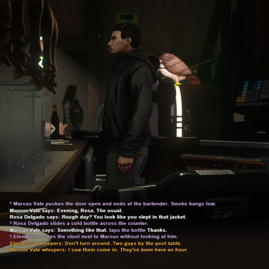
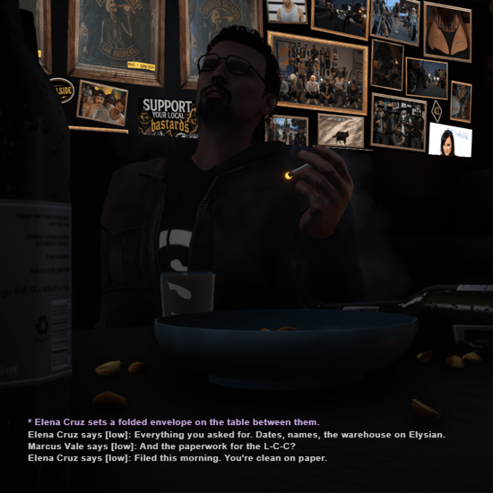
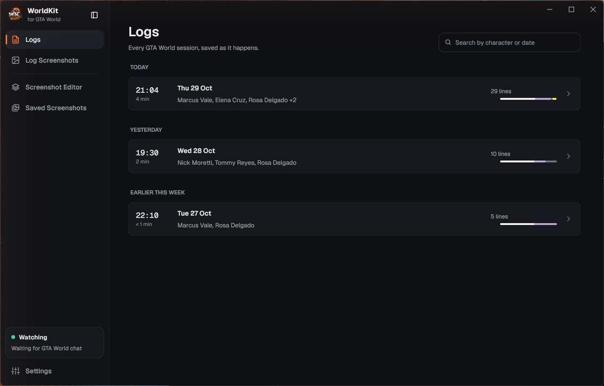
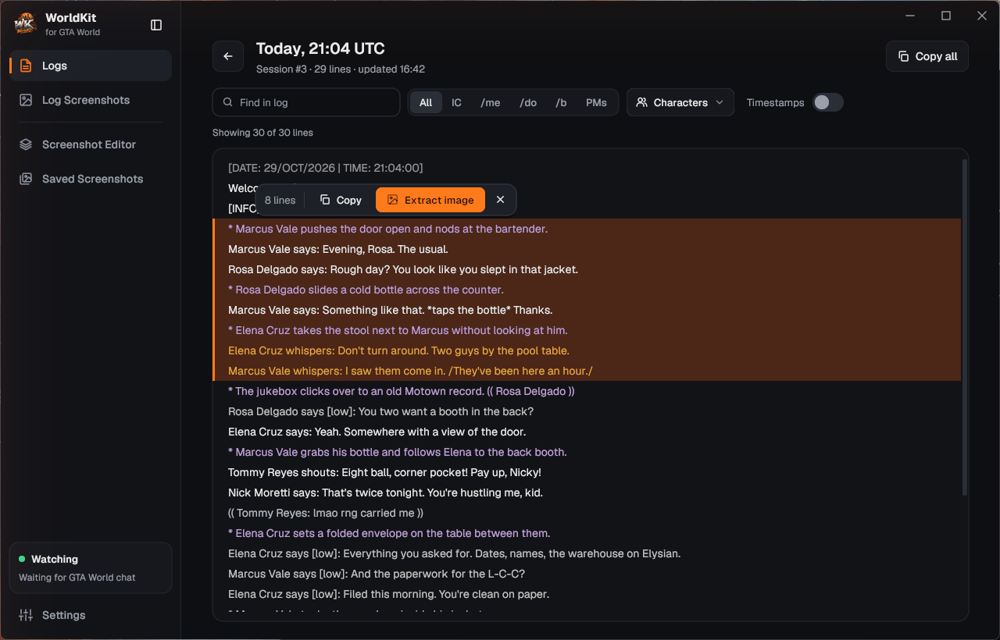
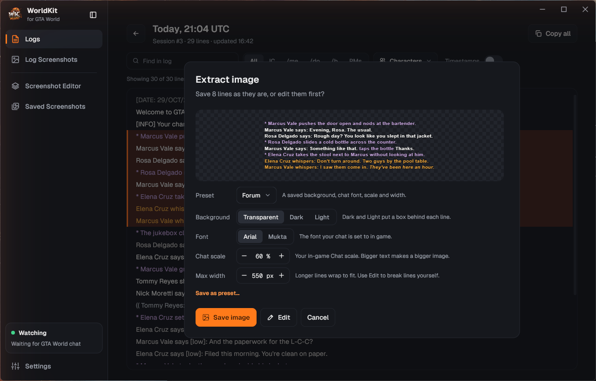
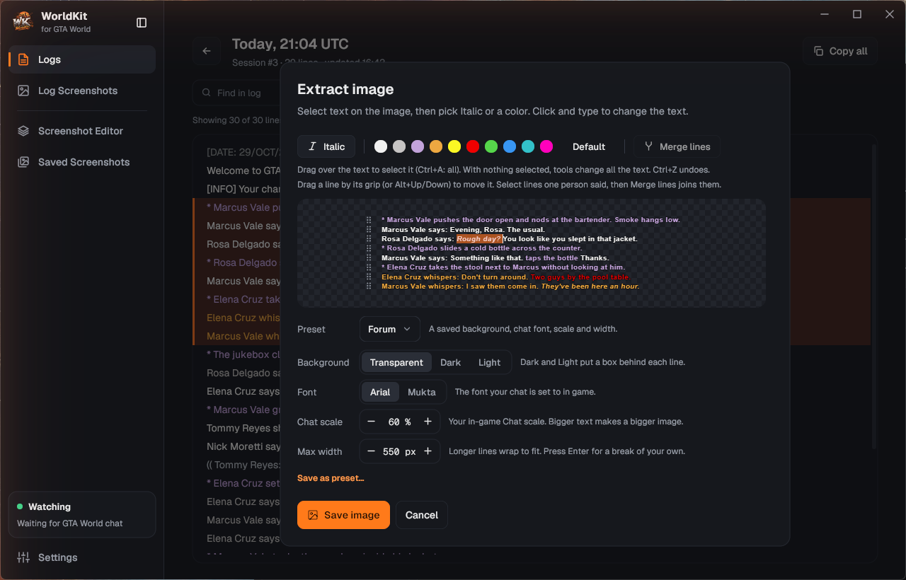
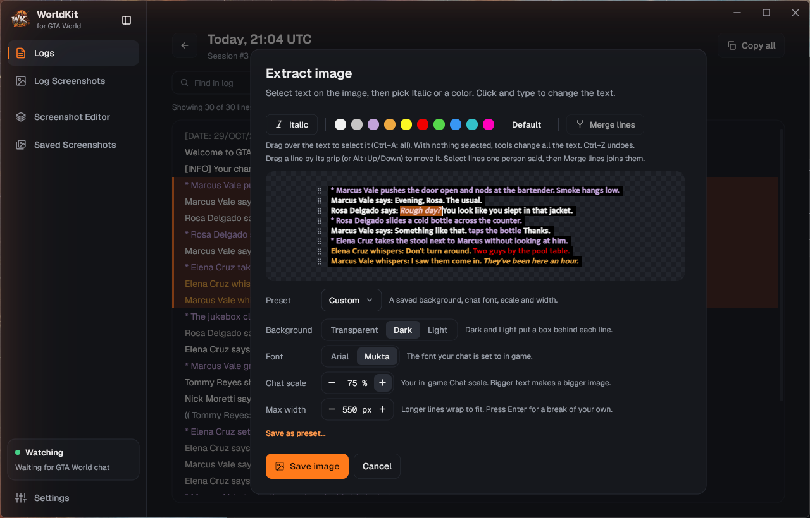
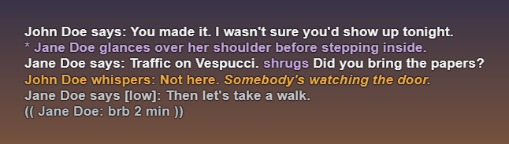
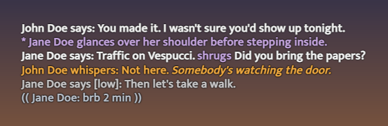
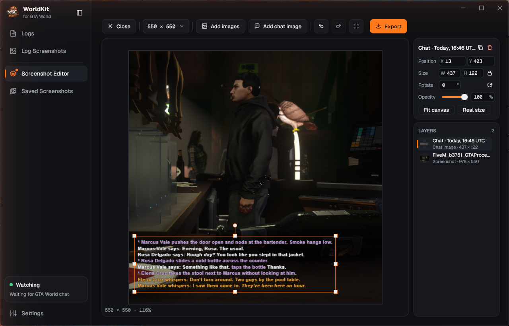

<p align="center">
  
</p>

<h1 align="center">WorldKit</h1>

<p align="center">
  A desktop companion for <b>GTA World</b> roleplayers: keep every chat log, turn it into
  in-game-looking chat screenshots, and compose them over your game shots.
</p>

<p align="center">
  <a href="https://github.com/vuenno/WorldKit/releases/latest"></a>
  
  
</p>

---

GTA World throws its chat away every time you reconnect. WorldKit saves it in the
background, lets you search and filter it, and turns any lines into transparent chat images
drawn exactly like the in-game chat, ready to lay over a screenshot.

<p align="center">
  
  <br>
  <sub>Two RP scenes made entirely in WorldKit: chat images (Arial, 60 %) laid over game screenshots on a 550 × 550 canvas.</sub>
</p>

## Features

### Chat logs, saved automatically

WorldKit watches FiveM while you play and saves each session's chat to a plain text file.
It reads a copy of FiveM's data, never the live files. Sessions are grouped by day, with
characters, duration and line counts at a glance.



### A log viewer built for RP

Find text, filter by kind (IC, /me, /do, /b, PMs) or by character, toggle timestamps, and
select lines to copy or extract.



### Chat screenshots that look like the game

**Extract image** turns selected lines into a transparent PNG drawn the way the in-game
chat is: same font (**Arial** or **Mukta**), same **chat scale**, same colors and soft
shadow, wrapped at the same width. `/italic/` and `*actions*` markup work as you type them
in game. Save your look as a preset.



### Edit the text right on the image

Click into the picture and type, select words and make them italic or recolor them with
the chat colors, drag lines into a new order, or merge lines one person said. Ctrl+Z undoes
any of it.



### Match your in-game chat

Switch the font and chat scale to what your game uses, cap the width, and add a dark or
light box behind each line when you need it. The preview redraws as you go.



<p align="center">
  <br>
  <sub>Arial, 100 %</sub>
</p>
<p align="center">
  <br>
  <sub>Mukta, 100 %</sub>
</p>

### Build whole RP scenes

The Screenshot Editor puts it together: pick a canvas (templates or any custom size), add
game screenshots and chat images as layers, then move, resize, rotate, fade and reorder
them freely. Export PNG or JPEG at the quality you choose; every export is listed on the
Saved Screenshots page.



## Install

1. Download `WorldKit-Setup-<version>.exe` from the
   [latest release](https://github.com/vuenno/WorldKit/releases/latest).
2. Run it, open WorldKit, and point it at your FiveM data folder if it doesn't find it.
3. Play. Your chat is saved as you go.

WorldKit runs on Windows 10 and 11 (64-bit) and can start with Windows. Your logs,
screenshots and settings stay on your PC in `%AppData%\WorldKit`.

## Build from source

Requires Go 1.27+ on Windows. No CGO.

```bash
go run ./cmd/worldkit
go build -ldflags="-H windowsgui" -o bin/worldkit.exe ./cmd/worldkit
go test ./...
```

New to the code? Start with [`PROJECT_OVERVIEW.md`](PROJECT_OVERVIEW.md), then
[`CLAUDE.md`](CLAUDE.md) (code rules) and [`DESIGN.md`](DESIGN.md) (visual rules).

## Credits

- UI built with [Gio](https://gioui.org).
- Fonts: [Geist](https://vercel.com/font) (UI) and [Mukta](https://fonts.google.com/specimen/Mukta)
  (chat images), both under the SIL Open Font License. Arial is read from Windows, never
  bundled.

WorldKit is a fan-made tool. It is not affiliated with GTA World, Cfx.re/FiveM or Rockstar
Games.
